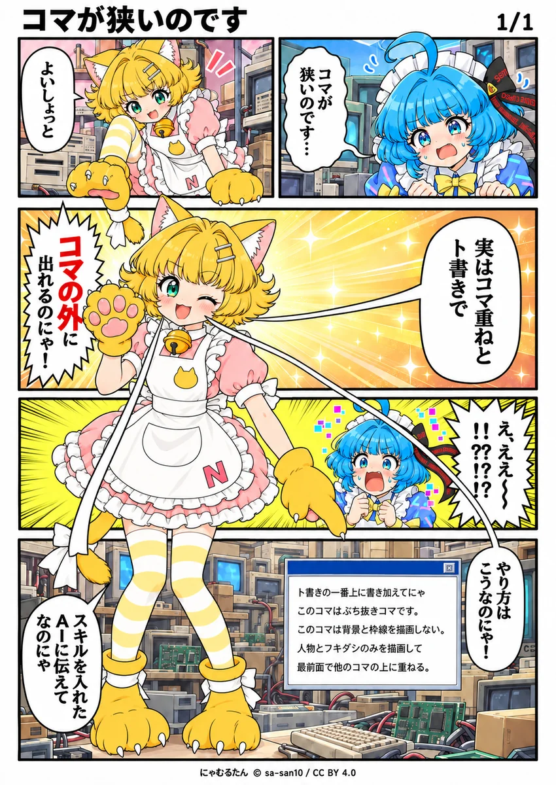

# 🫧 コマをぶち抜く ─ bg: -1 を「背景処理のプレースホルダー」にする

> 制作時の版：NDM（OMNY）10.31 ／ 標準OMAY v10.7 ／ 1ページ・6コマ ／ 2026-10-17



<sub>にゃむるたん © sa-san10 / CC BY 4.0</sub>

左に立っているにゃむるたんは、**6コマ目**です。

枠も背景もなく、奥の大ゴマ・帯・下段の上に直接立っています。
奥の3コマは、にゃむるたんの後ろでもページの左端までつながっています。

---

## しくみ

### 1. ぶち抜く人物を、最後の id のコマに入れる

コマが重なるとき、**id の昇順で奥→手前**に描かれます。
最後の id のコマが、いちばん手前に乗ります。

```yaml
- id: 6
  shape: {type: "rect", x: 22, y: 79, w: 86, h: 208}   # 3〜5コマ目に重なる縦長の範囲
```

### 2. そのコマを bg: -1 にして、action の先頭で描き方を指定する

```yaml
  bg: -1
  action: >-
    このコマは背景を書かない。枠線を書かない。人物とフキダシのみを描画して他のコマの上に重ねる。
    全身ぶち抜きの見せゴマ。……
```

### 3. 奥のコマは「左端から描いて、下に回り込む」

```yaml
- id: 3
  action: >-
    奥のコマ。ページの左端から右端までの横幅で描き、左側は手前の6コマ目の下に回り込む
    （背景の金のグラデと集中線は左端まで描く。右半分に縮めない）。……
```

奥のコマの人物・フキダシ・浮かぶウィンドウは、手前のコマに隠れない右側に置きます。

ぶち抜きのコマは「背景も枠線も描かない」と、はっきり書くのが近道です。

---

## なぜ bg: -1 なのか

bg の4つの値のうち、0・1・2 は「背景をどれだけ描き込むか」の指定です。
-1 だけは「**このコマの背景は特別な処理をする**」という目印です。

標準OMAY v10.7 では、bg: -1 の規定がすべて `[default]` です。

```yaml
- "[default] bg:-1 の背景色は既定の中間グレー1色のベタ塗り（グラデーション禁止）。
   ベタ塗り色は action に色指定があればそれで上書きする"
- [default] bg:-1=背景無描画（プレースホルダー）。既定では1色のベタ塗りのみを敷き、……
  action・style_notes に別の描き方の指定があればそれに従う
```

何も書かなければ、これまでどおり1色のベタ塗りです（後で背景を差し替える用）。
action に書けば、そのコマだけ別の描き方になります。

0・1・2 の規定は `[const]` のままなので、ほかのコマの背景は崩れません。

---

## ファイル

1ページ・6コマの『コマが狭いのです』。
狭いコマで困っているらきもたんに、にゃむるたんがコマの外へ出てみせて、やり方を空中に浮かぶウィンドウで教える話です。

- [コマが狭いのです_ぶち抜き.omny.yaml](./コマが狭いのです_ぶち抜き.omny.yaml) — ネームデータ
- [images/](./images/) — 生成結果（webp・長辺1200px に縮小）

© 2026 sa-san10
共著: クロちゃん
